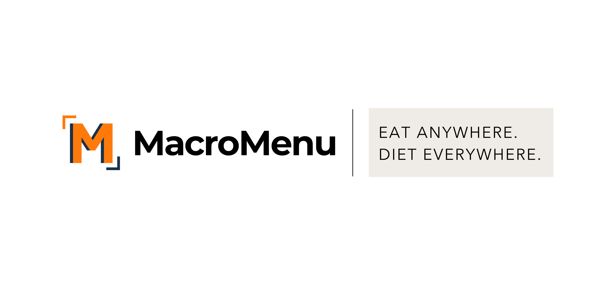
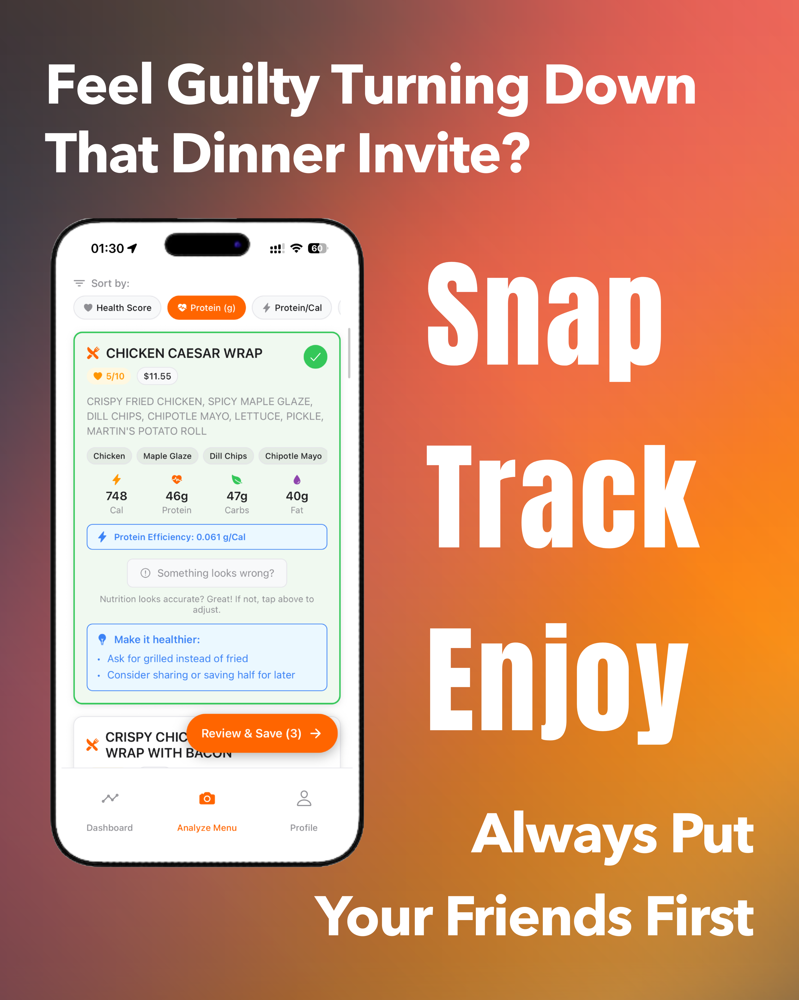

# MacroMenu

**Eat anywhere. Diet everywhere.**

A mobile-first web app that helps people stick to their nutrition goals when eating out. Snap a photo of a restaurant menu and MacroMenu extracts the items, estimates calories and macros for each dish, and ranks them against your goals.

Co-founded under **S.P. Solutions**. Main codebase: [wangalb/macromenu](https://github.com/wangalb/macromenu). This repo is a project showcase.

## Features
- **Menu analysis**: OCR with Google Cloud Vision, then LLM parsing into structured menu items
- **Nutrition estimation**: retrieval-augmented estimates of calories, protein, carbs and fat, with a QA and correction system
- **Ranking**: sort by health score, protein, or protein per calorie, with "make it healthier" suggestions
- **Tracking**: daily intake, weekly summaries, meal history, custom macro goals
- **Restaurant discovery**: location search with Google Places

## Tech stack
Next.js 15, React 19, TypeScript, Tailwind CSS, Radix UI, Supabase (PostgreSQL + Auth), Groq, Hugging Face inference, Sentry, PostHog, pnpm monorepo, deployed on Vercel.

